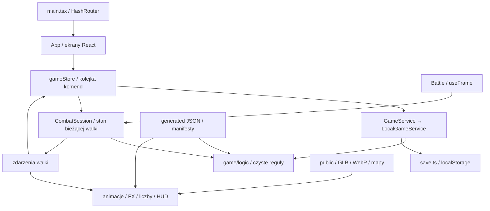

# Przekazanie prac: IdleLC, odzyskane zasoby i oryginalna mechanika

Stan rozpoznania: 2026-11-02. Punktem wyjścia wdrożenia jest commit `c9944c92cacfc50595dbfc8bbd085b64cf5e4048`. Ten dokument jest punktem wejścia dla Claude Code i kolejnych współpracowników; [raporty źródłowe](source-audit/README.md) zachowują szczegółowe dowody, a changelog w katalogu głównym opisuje faktycznie dostarczone zmiany.

## Kontynuacja po utracie niewysłanej partii

Checkout odtworzony na `461e964` był czysty; brakujące poprawki odtworzono z repozytorium
i ponownie pobranych, zweryfikowanych archiwów. Bieżący zakres i wyniki opisuje
[raport poprawek](fixes-2026-11-02.md). Przy kolejnej kontynuacji zacznij od tego raportu.

Źródłowe atrybuty, współczynniki HP/MP oraz raw hit/avoid działają obok dotychczasowego
adaptera głównych HP/ATK/DEF. Procenty opcji sprzętu i tytułów nie mnożą się wzajemnie.
Newbie, EXP/SP, wygasanie tytułów, STAT22/23/8 i block63 mają osobne poprawki oraz testy.
Nie traktuj tego jako pełnego portu statystyk i walki serwera ani zmiany zasad projektu.

Adapter ulepszeń korzysta z 108 grup i 145 definicji `Effect.dat`, oryginalnej wróżki,
pięciu pierścieni, tagów dłoni i ścieżek. Progi broni i minimum czterech części pancerza
są niezależne. Pełne emitery/trace/legacy MDL, efekty skilli i tytułów nadal wymagają
osobnych etapów. Zasoby regeneruje `npm run recover-upgrade-fx -- --client <klient> --models`.
Grafiki przejść map są dekodowane przed animacją i pokazywane w całości przez `contain`.
SaveVersion nadal 13; bez backendu ani Supabase.

## Cel i obowiązujący zakres

Właściciel zlecił etapowe wdrożenie ustaleń audytu. Najpierw uzupełniamy zasoby klienta, następnie poprawiamy potwierdzone błędy interpretacji i logiki. Rozbieżności wynikające z uzgodnionych rozwiązań IdleLC pozostają; pozostałe różnice zbieramy do decyzji punkt po punkcie. Nie wprowadzamy Supabase, kont sieciowych, nowego backendu ani bazy danych na tym etapie.

Ostatnia zgoda na pracę etapami obejmuje implementację i dokumentowanie działających kroków; nie trzeba ponownie pytać o każdy już uzgodniony etap. Przed zmianą zasad rozgrywki należy sprawdzić [rejestr decyzji](design-decisions.md). Starszy dziennik w `CLAUDE.md` zawiera historyczne informacje, np. o braku źródeł serwera, 184 tytułach czy brakującym kliencie. Te stwierdzenia nie opisują już dostępnych materiałów.

## Architektura wykonywanej gry

IdleLC jest lokalną grą przeglądarkową: React 19, TypeScript 6, Vite 8/Rolldown, Three.js 0.186, React Three Fiber 9, drei 10 i Zustand 5. Zapis mieszka w `localStorage`; nie ma zdalnego autorytetu ani serwera rozstrzygającego walkę. Asynchroniczny kontrakt serwisu przygotowuje przyszłą wymianę implementacji, ale sam nie zapewnia odporności na modyfikację klienta.



| Obszar                  | Główne pliki                                                                                                 | Odpowiedzialność i powiązania                                                                                                                                                                                                                                                  |
| ----------------------- | ------------------------------------------------------------------------------------------------------------ | ------------------------------------------------------------------------------------------------------------------------------------------------------------------------------------------------------------------------------------------------------------------------------ |
| Uruchomienie i trasy    | `src/main.tsx`, `src/App.tsx`                                                                                | `HashRouter`, inicjalizacja store, wybór/tworzenie postaci i ekran gry; lazy viewer modeli tylko po włączeniu narzędzi dev. Hash routing współpracuje ze statycznym Pages.                                                                                                     |
| Stan aplikacji          | `src/state/gameStore.ts`                                                                                     | Zustand, kopia zapisu, aktywna postać i rzadsze migawki HUD. Kolejka Promise szereguje komendy. Zmiana `heroKey` odświeża fightera, zachowując stan trwającej walki.                                                                                                           |
| Serwis i zapis          | `src/game/service/GameService.ts`, `LocalGameService.ts`, `index.ts`; `src/game/logic/save.ts`               | Wszystkie komendy zapisu przechodzą przez wspólny kontrakt. Lokalny serwis waliduje, przelicza nagrody i zapisuje kopie; wersja zapisu w punkcie wyjścia to 13. Migracje są konieczne po zmianie trwałego schematu. Przy niedostępnym storage używany jest magazyn pamięciowy. |
| Walka                   | `src/game/session/combatSession.ts`; `src/game/logic/combat.ts`, `fighters.ts`, `balance.ts`, `lcBalance.ts` | Sesja przechowuje HP/MP, timery i RNG. `combatTick` zwraca nowy stan oraz zdarzenia. `playerFighter` łączy bazę, sprzęt, tytuł i pasywki. `lcBalance` obecnie skaluje bohatera do median potworów; to własna formuła, nie oryginalne statystyki klas.                          |
| Progres i nagrody       | `progression.ts`, `rewards.ts`, `loot.ts`, `spots.ts`, `book.ts`                                             | EXP/poziom, SP, złoto, drop, otwieranie spotów i progi księgi. `reportCombat` kontroluje m.in. dopuszczalną liczbę zabójstw względem czasu. Nie jest to zabezpieczenie przed właścicielem lokalnej przeglądarki.                                                               |
| Ekwipunek i ekonomia    | `equipment.ts`, `options.ts`, `rare.ts`, `shop.ts`, `titles.ts`                                              | Zakładanie/zdejmowanie, zajmowane ręce, plusy, automatyczne opcje, identyfikacja rare, sprzedaż/zakup, kamienie i tytuły. Zmiana przedmiotu musi być widoczna jednocześnie w statystykach, walce, zapisie i modelu.                                                            |
| Umiejętności i mikstury | `skills.ts`, `potions.ts`, `combat.ts`                                                                       | Nauka/rangi, wymagania sprzętu, pasek i AUTO, koszt/odnowienie, efekty i szybkie sloty mikstur. Te same reguły trafiają do walki aktywnej i pomiarów AFK. Część znaczeń efektów jest tymczasowa; dokładna mapa jest w raporcie źródłowym.                                      |
| Wyprawa AFK             | `afk.ts`; `ui/expedition/*`                                                                                  | Wyprawa uruchamiana jawnie, max 8 h; krótsza niż 60 s nie płaci. Tempo mierzy próbka tej samej walki (1200 s, krok 0,1 s); rozliczenie w odcinkach 600 s uwzględnia poziomy i zużycie mikstur. To estymacja, nie odtworzenie każdej sekundy całej wyprawy.                     |
| Scena                   | `src/scene/GameCanvas.tsx`, `World.tsx`, `Battle.tsx`, `Character.tsx`                                       | R3F/Three: kamera, klatki walki, ruch, przejścia spotów, AnimationMixer, reakcje i etykiety. `Battle` tyka sesję i synchronizuje HUD co ok. 0,1 s; wyniki walki trafiają zdarzeniami do store i serwisu.                                                                       |
| Wygląd wyposażenia      | `src/game/assets/manifest.ts`, `gear.ts`; `scene/Character.tsx`                                              | Manifest bazowy jest nadpisywany danymi LC. Osobne GLB sprzętu są podpinane do szkieletu postaci; zakryte części ciała są ukrywane. URL i hash muszą odpowiadać plikowi. `ModelBoundary` daje zastępstwo przy błędzie modelu.                                                  |
| Teren i props           | `scene/lcMap.ts`, `LcTerrain.tsx`, `MapProps.tsx`; `public/maps/juno/`                                       | Shader warstw terenu i instancje drzew/domów/płotów z plików świata. Juno ma własny wybór aren, ponieważ spawny DB nie pasują do mapy. Nie przeliczać aren przy okazji odzyskiwania grafiki bez osobnej kontroli.                                                              |
| Efekty                  | `SkillEffects.tsx`, `UpgradeAura.tsx`, `upgradeEffects.ts`, `TitleAura.tsx`, `LevelUpEffect.tsx`             | Ulepszenia używają podzbioru `Effect.dat`, oryginalnych modeli, tagów i ścieżek; emisja cząstek/trace/MDL pozostaje adapterem. SkillEffects i TitleAura są własne. Nie jest to pełny silnik efektów LC.                                                                        |
| UI i komunikaty         | `src/ui/`, `state/toasts.ts`, `combatEvents.ts`, `floatingTexts.ts`, `src/index.css`                         | DOM nad sceną, okna, karty przedmiotów, panel postaci, HUD i podglądy. UI jest po angielsku, dokumentacja/rozmowa po polsku. Okna z zakładkami utrzymują stałą wysokość (`sheet--fixed`).                                                                                      |
| Dane LC                 | `src/game/data/lcSource.ts`, `lcTypes.ts`, `generated/`; moduły `data/*.ts`                                  | Eager import wygenerowanych JSON. Gdy danych nie ma lub `VITE_LC_DATA=0`, używane są dane zastępcze. Eksport jest wybranym podzbiorem bazy, nie pełną kopią oryginalnego modelu.                                                                                               |
| Import i konwersja      | `scripts/lc/`                                                                                                | SQL → dane; SMC/BM/BS/BA/TEX → GLB/WebP; mapy WTR/WLD → teren i props. `ClientFiles` rozwiązuje ścieżki z kilku katalogów klienta. glTF-Transform/meshoptimizer optymalizuje wyniki. Surowe pliki pozostają poza Git.                                                          |
| PWA i publikacja        | `public/sw.js`, `manifest.webmanifest`, `.github/workflows/deploy.yml`, `vite.config.ts`                     | Service worker buforuje shell i zasoby. CI na Node 22 wykonuje instalację i kontrole, a push na `main` publikuje Pages pod `/IdleLC/`. Zmiana cache może wpływać na otwarte karty i aktualizację zasobów.                                                                      |

Dane `generated/`, modele, arkusze ikon i mapy są wyjściami importerów, mimo że zgodnie z decyzją właściciela są commitowane. Ich ręczna edycja bez zmiany źródła lub reguły importu zostanie utracona przy regeneracji. Bazowe dane/model CC0 pozostają działającym fallbackiem i podstawą testów, nie porzuconym kodem do usunięcia. `public/assets-local/` i `assets-src/` są ignorowanymi lokalnymi obszarami eksperymentów/źródeł. Narzędzia dev są jawnie warunkowe; widok modeli nie jest zwykłym ekranem gracza.

Gra ma zaimplementowane lokalne postacie, zapis/migracje, aktywną walkę, progres, ekwipunek, sklep, opcje/rare, umiejętności, mikstury, tytuły, księgę, wyprawy i PWA. „Zaimplementowane” oznacza działający przepływ IdleLC, a nie zgodność wszystkich wzorów z LC. Niepełne pozostają przede wszystkim oryginalna mechanika walki, semantyka części specjalnych efektów, wierne FX, osobne tereny pozostałych stref oraz przyszły serwer. Nieobsługiwany podtyp danych nie powinien otrzymywać przypadkowego zachowania tylko po to, aby UI pokazywał efekt.

## Najważniejsze przepływy

**Nowa/wybrana postać:** ekran React → komenda store → `LocalGameService` → walidacja i zapis → kopia postaci w store → inicjalizacja `CombatSession`. Wygląd bierze klasę i IDs założonych przedmiotów; nie jest zapisanym osobnym zestawem meshów.

**Zabójstwo w walce:** `Battle.useFrame` → `CombatSession.tick` → zdarzenie śmierci i prezentacja → `gameStore` → kolejka `reportCombat` → walidacja raportu i naliczenie EXP/SP/złota/dropu → zapis postaci → odświeżenie store i, gdy zależności się zmieniły, fightera. Potions użyte i zgłoszone są śledzone osobno, żeby nie zostały ponownie wydane przed odpowiedzią serwisu.

**Zmiana sprzętu/identyfikacja/opcja:** komenda serwisu zmienia instancję przedmiotu → store aktualizuje postać → klucz fightera powinien obejmować wszystkie wartości wpływające na walkę → `playerFighter` przelicza statystyki i dostępność skilli → scena osobno aktualizuje GLB. Sam UID przedmiotu i jego plus nie wystarczają do wykrycia każdej zmiany opcji.

**Wyprawa:** `startAfk` zapisuje start i zatrzymuje walkę aktywną. `claimAfk` liczy czas, symuluje tempo i nagrody, zużywa zapas mikstur, zapisuje wynik oraz wznawia scenę. Naturalna regeneracja za nieobecność i wynik wyprawy nie są tym samym mechanizmem. Przy zmianie walki trzeba sprawdzić też AFK i estymację godzinową.

## Dane i rozwój projektu do punktu odniesienia

Wygenerowane dane zawierają 279 potworów, 9 stref, 2052 przedmioty, 119 umiejętności, 199 tytułów, 112 typów opcji i 66 zestawów rare. W UI dostępne są cztery strefy: Juno, Dratan, Merac i Egeha; limit poziomu wynosi 100. Liczby we wcześniejszych wpisach `CLAUDE.md` pochodzą z kolejnych etapów importu i nie zawsze są aktualne. Obecność danych dziewięciu stref nie oznacza zgody na ich udostępnienie.

Ostatnie istotne zmiany w Git przed audytem:

| Commit               | Zmiana                                                       |
| -------------------- | ------------------------------------------------------------ |
| `c9944c9`            | Własne efekty ulepszenia broni i tytułów                     |
| `5cef028`            | Ekran ładowania podczas zmiany strefy                        |
| `1358788`            | Cztery grywalne strefy i limit poziomu 100                   |
| `177caec`, `6aec53a` | Etykiety postaci i siedem stabilnych pól paska skilli        |
| `7d854d9`, `0236ec3` | Props Juno z WLD oraz ruch między spotami                    |
| `da6f63e`            | Jawne rozszerzenia specjalnych zestawów rare od poziomu 77   |
| `ea19a52`            | 199 tytułów, Newbie/Rising Star, zapis v13                   |
| `3228a7a`            | Nagrody księgi, łatwiejsze ulepszanie i stała wysokość okien |

Historia i komentarze dokumentują rozdzielenie serwisu dla przyszłego Supabase, stopniowy import klienta oraz wiele własnych zasad właściciela. Nie należy przypisywać autorowi innych intencji wyłącznie na podstawie nazwy funkcji lub obecności nieużywanej gałęzi.

## Etapy wdrożenia i kryteria zakończenia

Poniższa tabela jest planem wynikającym z audytu. **Status „do wdrożenia” nie oznacza dostarczenia w grze.** Po ukończeniu etapu aktualizujemy status, changelog i dowody weryfikacji.

| Etap | Zakres                                                                    | Stan przy sporządzeniu dokumentu                                                                                                                                   | Warunek zamknięcia                                                                                                              |
| ---- | ------------------------------------------------------------------------- | ------------------------------------------------------------------------------------------------------------------------------------------------------------------ | ------------------------------------------------------------------------------------------------------------------------------- |
| A    | Raporty, pochodzenie, mapa architektury i decyzje                         | Udokumentowano w `docs/source-audit/` oraz tym dokumencie                                                                                                          | Spójne linki, jawne ograniczenia, odróżnienie planu od wdrożenia                                                                |
| B    | Poprawne MESH/TEX i bezpieczne granice czytnika                           | Zintegrowano; ścisła regeneracja zakończona bez nieoczekiwanych braków                                                                                             | Testy asymetrycznego materiału, FRMC wewnątrz FRMS i uszkodzonych danych; dotychczasowe fixture'y nadal działają                |
| C    | 283 modele wyposażenia, pełne arkusze ikon i manifesty                    | Wygenerowano komplet; końcowa kontrola CI/przeglądarki wraz z pakietem                                                                                             | 258 teksturowanych zamiast kolorów, 19 oryginałów zamiast zamienników, 6 rękawic; 2052/119 mapowań; brak nieplanowanych ubytków |
| D    | Elder Drake, oryginalny Cursed Weaver/Lich, czytelne główne animsety klas | Wygenerowano w tej samej partii; końcowy test w grze wraz z pakietem                                                                                               | Komplet części/klipów, test w grze, fallback zachowany dla rzeczywiście nieczytelnego źródła                                    |
| E    | Wybrane GUI i poprawne paski ładowania                                    | Wygenerowano 33 wycinki i zintegrowano CSS; końcowy test w grze wraz z pakietem                                                                                    | Wycinki w granicach atlasów, właściwy cel potwierdzony w źródle; bez masowego nadpisywania identycznych obrazów                 |
| F    | Roślinność Juno                                                           | Wdrożono 15 brakujących modeli i 4188 instancji z zachowaniem istniejących zasobów                                                                                 | Zachowane areny i istniejące props, poprawne pozycje, test wydajności/zasłaniania kamery                                        |
| G    | Oryginalne FX                                                             | Adapter 108 grup ulepszeń z modelami/tagami/ścieżkami; pełny renderer nadal otwarty                                                                                | Pełne definicje i zależności, odtwarzacz, kontrola czasu/blendingu/tagów i porównanie wizualne                                  |
| H    | Potwierdzone błędy lokalnej logiki i interpretacji                        | Zintegrowano odświeżanie fightera po zmianie opcji oraz poprawki cache PWA; dodano poprawną semantykę stałego/procentowego odzysku HP/MP; pozostałe skille otwarte | Test odtwarzający problem, spójna walka aktywna/AFK/UI/zapis, zachowane decyzje właściciela                                     |
| I    | Pełna mechanika z serwera                                                 | Dokumentacja gotowa; dane i migracja modelu niepełne                                                                                                               | Kompletny dump/profil, rozszerzony model, przypadki referencyjne i migracje; brak zgadywania wartości                           |
| J    | Supabase                                                                  | Poza bieżącym zakresem                                                                                                                                             | Dopiero ostatnia faza na osobne zlecenie; plan w `supabase.md`                                                                  |

### Odtwarzalny zakres pierwszej partii

Lista `scripts/lc/batches/recovery-2015.json` wskazuje 292 zadania: sześć ciał klas, trzy potwory i 283 modele wyposażenia. Każda pozycja ma powód włączenia, a wyposażenie także źródło i IDs przedmiotów. Jedynym dopuszczonym brakiem jest nieobecny klip Titana `ti_skill_10`; nie dodano zgadywanego aliasu. Pozostałe brakujące lub nieczytelne zależności mają przerwać ścisłą konwersję.

Pierwsze wykonanie tej partii zakończyło się wynikiem **292 skonwertowane / 0 niepowodzeń**, bez zastępczych tekstur i pominiętej geometrii. Oddzielnie wygenerowano arkusze 2052/2052 i 119/119 mapowań ikon oraz 33 elementy GUI. To wyniki konwersji; końcowe testy całego buildu i gry trzeba raportować oddzielnie.

Po umieszczeniu czytelnego klienta poza repozytorium:

```sh
LC_CLIENT_2015="/sciezka/do/2015 client"
npm run convert-lc -- --client "$LC_CLIENT_2015" --batch scripts/lc/batches/recovery-2015.json --strict
npm run convert-lc -- --client "$LC_CLIENT_2015" --only icons,ui
npm run recover-lc-props -- --client "$LC_CLIENT_2015" --map juno
npm run verify-lc-recovery
```

Polecenia zapisują zasoby produkcyjne i odpowiednie manifesty. Wykonuj je przy kontrolowanym stanie checkoutu i sprawdzaj diff, zamiast traktować `--out` jako izolację wszystkich wyjść.

Nowy, strukturalny odczyt `skills.lod` potwierdza 1787 rekordów oraz checksum/EOF. Daje 75 mapowań dla danych IdleLC. Cztery starsze mapowania (10/11/23/51) zachowano wobec pustych rekordów klienta 2015, więc zintegrowany manifest ma 79 wpisów. Wcześniejsza heurystyka 78 wpisów z audytu nie jest wynikiem nowego parsera. Warianty broni zachowano w metadanych; frontend nadal używa pierwszego wariantu.

Źródło `actions.lod` wskazuje ikonę Titles jako akcję 49: `ActionBtn0`, wiersz 6, kolumna 0. Wycinki nicku/tytułu potwierdzono w `UIManager.cpp`/`ActorMgr.cpp`, a loading w `GameMP/Map.cpp`. Pozostaje do porównania dokładna kolorystyka/tint oryginalnego tła tytułu; sama integracja atlasu nie gwarantuje identycznego wyglądu.

## Potwierdzone problemy i ryzyka do pilnowania

**Problemy odtworzone w punkcie wyjścia:** błędna kolejność pól materiału MESH, rozpoznanie fałszywego FRMC w surowych pikselach Wyverna, wymuszone zamienniki mimo czytelnego oryginału, brak 91/12 mapowań ikon i wycinki loading poza granicami. W logice klucz fightera nie uwzględniał zmiany opcji/rare na tym samym UID i plusie; mogło to pozostawić nieaktualne statystyki walki. Każdy punkt powinien być odhaczony dopiero po odpowiedniej korekcie i weryfikacji, nie na podstawie samego wpisu w raporcie.

**Potwierdzone różnice semantyki:** enumy i koszty skilli, regeneracja, kanały walki, algorytm dropu oraz złoto. Szczegółowe raporty wskazują osiągalny kod i brakujące pola. Nie wszystkie różnice nadają się do małej lokalnej poprawki bez zmiany modelu lub decyzji balansu.

**Ryzyka architektoniczne:** rozbudowane `combat.ts` i `gameStore.ts` łączą wiele ścieżek; `index.css` jest wspólny dla wszystkich okien; konwersja aktualizuje kilka powiązanych manifestów; geometria/rig/animacje muszą pozostać zgodne; ciężkie modele, trawa i FX mogą obniżyć płynność telefonu; PWA może podać starsze zasoby po publikacji. To obszary wymagające kontroli, nie dowód awarii każdego z nich.

**Ryzyko przyszłego backendu:** obecny lokalny zapis i RNG można zmienić z przeglądarki. Przy Supabase serwer musi weryfikować komendy i rozstrzygać nagrody; przeniesienie obecnego JSON do tabel nie zapewni tego samoistnie. Na razie nie budujemy backendu ani pozornych zabezpieczeń sieciowych.

## Weryfikacja i bezpieczna kontynuacja przez Claude Code

1. Odczytaj aktualne `CLAUDE.md`, changelog, ten dokument i rejestr decyzji; sprawdź `git status`, HEAD i zmiany od ostatniego opisanego etapu. Nie odtwarzaj już opublikowanych zmian środowiska i nie nadpisuj cudzej pracy.
2. Dla tematu serwerowego otwórz odpowiedni raport, źródło o wskazanym hashu i faktyczną osiągalną gałąź. Sprawdź profil/flagę, jednostki, signedness, dzielenie całkowitoliczbowe i kolejność bonusów. Nie portuj martwej starszej funkcji tylko dlatego, że jej wzór wygląda prościej.
3. Dla zasobów używaj selektywnej konwersji (`--only`), kontroluj wszystkie zapisane manifesty i diff. Nie uruchamiaj domyślnej masowej konwersji w celu naprawy jednego modelu. Dane i GLB/WebP muszą pochodzić z tego samego kroku; nie kopiuj materiałów diagnostycznych jako gotowego produkcyjnego parsera.
4. Zmianę danych trwałych poprzedź migracją i zachowaniem dotychczasowych zapisów. Regeneracja samych zasobów nie powinna wymagać resetu postaci ani zmiany saveVersion.
5. Uruchom `npm run check` i `npm run build`. CI wykonuje lint, Prettier, TypeScript i Vitest. W bazowym audycie było 230 testów w 25 plikach; wynik nowego etapu należy zapisać osobno. Testy korzystają z danych zastępczych i nie obejmują pełnego renderingu LC.
6. Sprawdź build w przeglądarce z rzeczywistymi danymi: nowa i istniejąca postać, sprzęt/animacje, odzyskane potwory, ikony, zmiana strefy, walka i AFK. Sprawdź konsolę, błędy sieci/404 oraz powrót po odświeżeniu. Dla PWA sprawdź aktualizację cache i otwartą wcześniej kartę. Dla trawy/FX zmierz też koszt na urządzeniu docelowym.
7. Zapisz mały, działający etap, jego rzeczywistą walidację i pozostałe ograniczenia w changelogu; odśwież stan tego dokumentu i `CLAUDE.md`. Repo ma workflow publikujący push `main` na Pages, więc przed pushem sprawdź komplet plików oraz zdalny HEAD; bez force push i bez surowych archiwów.

Nie istnieje automatyczna gwarancja „nic się nie zepsuje”. Spójność zapewniają mały zakres zmiany, test problemu, pełne kontrole projektu, test rzeczywistych danych i możliwość wycofania konkretnego etapu.

## Co wciąż wymaga zbadania

- Pełny dump SQL zgodny z importowanymi danymi i profil oryginalnego serwera; bez tego nie odzyskamy utraconych slotów dropu, szans magic ani warunków skilli.
- Projekt rozszerzonego Fighter/Character: atrybuty, profesje, osobne kanały, hit types i migracja zapisów przed przeniesieniem całych formuł.
- Pełne EPGM/EEFM, attachmenty/tagi, procesory i blend modes FX; aktualna diagnostyka obejmuje tylko część formatu.
- Równoważność `ti_skill_10`/`ti_skill10`, użycie nowych wycinków GUI i brakujących fontów bez zgadywania.
- Wydajność odzyskanej roślinności Juno na fizycznym telefonie, starszy MESH16 `st_sheaf02`, osobne tereny pozostałych trzech stref oraz źródłowe punkty spawnów.
- Otwarte decyzje właściciela: bossy rajdowe, źródła tytułów, indywidualne nagrody księgi oraz różnice z rejestru decyzji.

## Pierwsza korekta semantyki z serwera

MT_RECOVER (4) HP/MP rozróżnia teraz ONLYPOWER (0, stała ilość) i RATE (2, procent aktualnego
maksimum zasobu, zaokrąglony w dół). ADDITION (1) jest odrzucane jako nieobsługiwane dane,
tak jak w `S/GameServer/Skill.cpp:1840,1906`. Walka i opis UI używają tych samych jednostek.
27 takich efektów w obecnych danych ma typ 0, więc dotychczasowych wartości nie przeliczono.
To mała, zweryfikowana korekta; pełny system skilli, statusy, statystyki klas i damage nadal
mają ograniczenia opisane w raportach. Nie zmieniono safe upgrades, saveVersion ani backendu.

## Weryfikacja wdrożonego pakietu

2026-11-02: `npm run check` zakończone pomyślnie (271 testów, 31 plików), `npm run build`
i `npm run verify-lc-recovery` również. Weryfikator czyta wszystkie 292 GLB, nie tylko metadane;
sprawdza skończone accessors, nazwy kości, komplet mapowań i hashe URL. Szczegóły w
[source-audit/recovery-validation.json](source-audit/recovery-validation.json).

Chromium/WebGL2 na produkcyjnym buildzie: wszystkie sześć klas z odzyskanymi rękawicami;
9 modeli klas/potworów z łącznie 145 klipami w viewerze; utworzenie postaci, przyznanie nagrody
za zabicie i zachowanie zapisu po reloadzie. Scena z 56 modelami props działa także w układzie
390×844. Końcowy test viewer/sceny nie zgłosił błędów strony, konsoli ani HTTP.
Nie jest to inspekcja wszystkich klatek i kombinacji sprzętu ani pomiar wydajności telefonu.

Dodatkowy test sceny: Elder Drake, Cursed Weaver i Cursed Lich w faktycznej walce (nie tylko
w viewerze), przejazd do areny o największej gęstości odzyskanej roślinności i wyprawa AFK 1 h.
Wszystkie ścieżki zakończone poprawnie, zero błędów strony, konsoli i HTTP.

PWA sprawdzono również z wyłączoną siecią: odświeżenie uruchamia grę z `idlelc-v2`,
z tym samym zapisem postaci i WebGL2, bez błędów strony ani konsoli.

Commity wdrożenia na `main`:

- `c60bd3b` — zasoby, parsery, GUI, PWA i dokumentacja audytu.
- `05a56c1` — odświeżanie statystyk sprzętu i jednostki natychmiastowego HP/MP.
- `9686d6e` — uzupełnienie roślinności Juno bez wymiany wcześniejszych propsów.

Push potwierdzono zdalnym HEAD. Lokalna walidacja jest zakończona; odczyt statusu GitHub Actions
przez API zwracał `Forbidden`, więc w tej sesji nie potwierdzono zakończenia zdalnego CI/deployu Pages.
