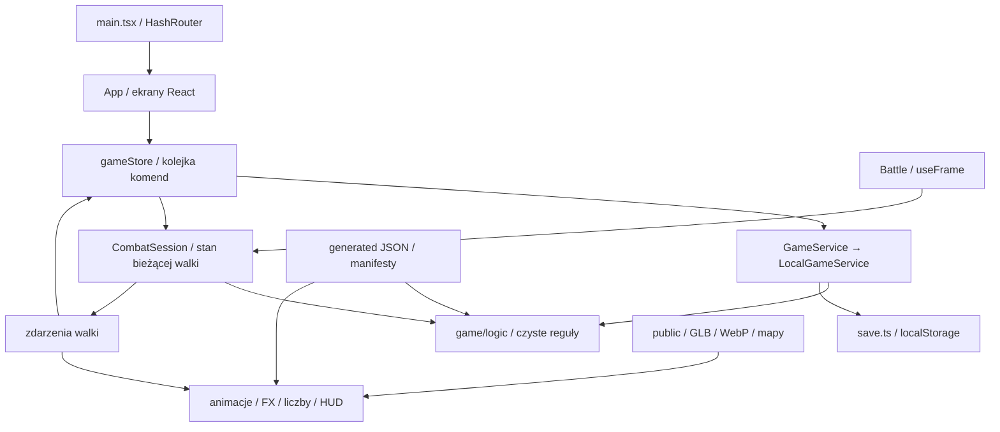

# Przekazanie prac: IdleLC, odzyskane zasoby i oryginalna mechanika

## Laca Ball: właściwa pula SubHelper i Auto (Codex), 2026-11-11

[Aktualne reguły i źródła](lacaball.md), baza `568b06b`, SaveVersion **19**.
Poprzedni wariant t_lacarette zastąpiony nowszym t_lcball / MSG_EX_LCBALL.
Pięć kursów na każdą z dwóch walut, pięć wygranych na kurs, liczniki remaining/max,
jeden żeton za grę. Jackpot `1/1` resetuje cały wygrany kurs po wypłacie.
Pule i rezerwacja są trwałe, wspólne dla postaci lokalnego konta. Backend globalnej
puli wszystkich graczy nie jest częścią obecnej aplikacji localStorage.
Migracja zachowuje stare opłacone wyniki, bez ponownego pobrania stawki.
Okno szersze, tabela węższa, bez Exit, poprawiony źródłowy X. Ręcznie 2000 ms,
Auto Draw ×2 1000 ms; kapsuła znika po 1500 ms. Auto zatrzymuje się po X,
ukryciu karty, odznaczeniu albo wyczerpaniu żetonów. Nie wraca samo po reloadzie.

## Laca Ball, złota niedziela i Moonstone Auto ×2 (Codex), 2026-11-11

[Pełna notatka, źródła, tabela nagród i zasady zapisu](lacaball.md).
SaveVersion **18**, bez utraty dotychczasowego postępu. Dwa bilety 500 Cash
za niedzielę (Weekly + Monthly), złota karta na całą szerokość tygodnia;
kalendarz w trzeciej kolumnie na lewo od Dungeons. Jego poprzednie miejsce
zajmuje Laca Ball z oryginalną maszyną, kursami i animacją.
Token 1% w centralnym rewardKills, niezależnie od poziomu i mnożników.
Gold token wyłącznie ItemShop, także usunięty z przyszłych nagród Perfect
Moonstone. Pakiety 100 Token/1000 Cash i 50 Gold token/750 Cash.
Koszty i wagi Laca Ball ze źródeł; zawartości nagród są konfiguracją właściciela.
Pending zapisuje jeden wynik i opłatę, payout po animacji. Nie zastępować
begin/finish pojedynczą natychmiastową wypłatą. Moonstone Auto ×2 ma 1500 ms
i 350 ms przerwy; czas rezerwacji musi odpowiadać animacji.

## Kompaktowy kalendarz i Moonstone (Codex), 2026-11-11

Baza `915810b`, SaveVersion **17**. Zmiany w warstwie GUI: kalendarz ma licznik
w pasku na górze, siatkę dat i przycisk prezentów w jednym widoku. Nie ma stałej
sekcji szczegółów ani odbioru pod siatką. Kliknięcie daty lub przycisku otwiera
kolejny Sheet. Claim dzisiejszych prezentów wywołuje istniejące claimLoginCalendar;
Return niczego nie przyznaje. Modal daty przyszłej/przeszłej służy podglądowi.
Focus trap obsługuje najwyższe okno i przywraca poprzedni przycisk.

Moonstone: cały dolny moonstone-info usunięty z JSX i CSS. Auto jest w obrębie
samego oryginalnego panelu, po prawej u góry; status, błąd i wynik trafiają do
pola tytułu. Widok Statui kończy się oryginalnymi guzikami Start/Exit.
Mechanika rezerwacji i wypłaty po animationend pozostaje opisana w moonstone-cash.
[Szczegóły kalendarza](login-calendar.md).

## Kalendarz i poprawki Statui (Codex), 2026-11-10

[Pełna notatka](login-calendar.md). SaveVersion **17**, migracja v16 bez utraty
Cash, gear i rezerwacji Statui. Nowy kalendarz jest wspólny dla konta: jeden claim
UTC na oba tory razem, po 10 minutach foreground. `CalendarRuntime` żyje podczas
gry postacią, heartbeat co 5 s. `calendarPresence` odmierza czas sam w serwisie;
load, zmiana postaci i długie przerwy nie dają czasu online. Zmiana daty resetuje
czas, utrzymuje historię; cofnięcie daty blokuje wcześniejszy odbiór.

`claimLoginCalendar` zapisuje inventory i datę odbioru razem, z rollback po
konflikcie i BagFeed po zapisie. Nie używać playSeconds, DEV timeScale ani AFK.
Obecność w widocznej karcie obejmuje też okna i Dungeons. Źródłowe GUI kalendarza
z calendar.xml/CalendarUi, ikona to akcja 52; nagrody są konfiguracją IdleLC.

World Boss dodatkowo 2547 ×5 i 2548 ×3, nadal bez mnożników dropu. Cash Ticket
ma teraz ikonę 7341 (ItemBtn15 1/2). `calendar-art.mjs` zmienia tylko sześć własnych
ikon w lc-data i przelicza atlas przedmiotów wraz z revision. Statua używa czystej
ramki EventBtn0 i centralnej twarzy, bez drugiego symbolu pod spodem. Modal ma
sam oryginalny panel i opisy, bez zewnętrznej ramki oraz X; focus trap i Exit zostają.

Weryfikacja: **634 testy / 79 plików**, check/build. Chromium 320/390/1280 px,
próba produkcyjna licznika, jednego claimu na oba tory, zmiany postaci, reloadu,
nowego biletu i dodatkowych kamieni Balroga. Przygotowane zapisy; próg dziesięciu
minut w testach serwisu, ostatnie 30 s przygotowanego postępu w realnym GUI.

## Statua: animacja od prawej do lewej i rezerwacja (Codex), 2026-11-10

Baza `c632560`. Nowy `menu-moonstone.webp` składa twarz z MoonStone.tex z jedną
ramką EventBtn0. W modalu 42 ikony jadą w lewo, wygrana w komórce 36 zatrzymuje się
pod centralnym znacznikiem; czas 3 s niezależny od tempa walki. Dekoracyjne ikony
nie losują nagród. Nazwa, inventory i BagFeed aktualizują się dopiero po animationend
oraz klatce renderowania, także przy systemowym ograniczeniu animacji.

Usunięte API `playMoonstone`/`applyMoonstonePlay`: teraz `beginMoonstonePlay`
rezerwuje kamień i zapisuje jeden wynik w opcjonalnym `moonstoneSpin`, a
`finishMoonstonePlay` rozlicza go raz po zgodnym ID i minimum 3 s. Obie operacje
zapisują stan oddzielnie i cofają pamięć po konflikcie zapisu. Wypłata nie nadpisuje
inventory kopią ze Start. SaveVersion nadal 16, sanitizer zachowuje rezerwację.

`useMoonstoneRound`: Stop/Exit czekają na bieżącą animację; automat zaczyna następną
po 700 ms wyniku. Ukrycie karty wyłącza automat i pauzuje tę samą rundę; Resume
animuje od początku bez drugiego kamienia. Reload otwiera paused modal, bez wypłaty
za sam upływ czasu i bez przywracania auto. Źródłowe wagi, ilości i flagi bez zmian.
[Pełny opis](moonstone-cash.md).

Weryfikacja: **623 testy / 77 plików**, pełne check i build. Chromium 320/390/1280 px:
rzeczywisty ruch w lewo, wynik pod znacznikiem i BagFeed po animationend.
Próba produkcyjna potwierdziła automat, pauzę także po Stop/Exit, ponowne otwarcie
i reload, bez podwójnego kamienia lub nagrody. Zdarzenie ukrycia karty symulowane
przez visibilitychange; przygotowane zapisy, bez pomiaru balansu i wydajności.

## World Boss loot, Cash tickets i Statua (Codex), 2026-11-10

[Pełna notatka i źródła](moonstone-cash.md). Drop właściciela jest w
`worldBossDropTable`, surowy t_npc_dropraid pozostaje w danych. Nowe bilety Cash
95011..95016; wspólne saldo save.cash oraz zużycie biletu zapisują się razem.
Moonstone Box 2544 otwiera istniejący system boxes z wagami serwera 520/300/150/30.

`scripts/lc/moonstone.mjs` importuje pięć pul t_moonstone_reward, w tym ilości,
flagi i rzeczywiste sumy wag 100/100/100/102/105. Statua używa CUIGamble i grafik
MoonStone.tex, dostęp pod Item Shop. Pierwotna natychmiastowa wypłata została
zastąpiona rezerwacją i rozliczeniem opisanymi w nowszej notatce powyżej.

Ważne: `ItemStack.flag` to poziom source mineralów 498..501, nie opcja ekwipunku.
Łączenie, pobieranie, sprzedaż, nazwy i v16 reload rozróżniają ID+flag. Nie usuwać
tej metadanej przy dodawaniu przyszłego użycia mineralów. Pozostałe przedmioty
nagród zachowują źródłowe ID i ilości. Starsze pola i SaveVersion nadal 16.

## World Boss: bieżący spot, kamera i Book (Codex), 2026-11-10

Ta partia zastępuje poprzednią podróż do bossa: `arenaMonsterId` to bieżący zwykły
spot, a `replaceMonsterHere` wymienia cel w miejscu, zachowując HP/efekty bohatera.
Zaczyna od spawning, nie tworzy travel ani zdarzenia podróży. `resumeWorldBossSpot`
wznawia zwykłego potwora w miejscu po wygranej, śmierci i Leave. Powrót trasą
pozostaje tylko dla starych zapisów z innym arenaMonsterId. Pomiar walki, dropy,
jednorazowa wypłata i zapis pending działają jak w drugiej partii. Nadal v16.

`bossCamera.ts` mieści oba modele pod HUD na telefonie i desktopie. Charakter
bossa mierzy maksymalną wysokość kolejnych póz do kadru; kamera uwzględnia zbocza
na linii do obu postaci. Bieżąca kość Head prowadzi
etykietę i pasek HP (72 px). Mgła uwzględnia odległość kamery od bohatera, a
`selectProps` ma opcjonalny zasięg istniejącego korytarza dla wysokich dekoracji.
Oba rozszerzenia działają wyłącznie podczas World Bossa; zwykłe ustawienia i
promień wyszukiwania dekoracji 120 m zostają. Nie zmieniono modeli ani animacji.

Przycisk 48 px nad środkiem. Stoper i wynik korzystają z istniejących cash-bar,
cash-card, detail-window, name-frame i slotów klienta. `worldBookMonsters` dopisuje
bossa na końcu Book, poza `zoneSpots`; progi 10/100/1000/10000 i Heaven Stone
1/2/5/10 są wspólne ze zwykłymi potworami. Starsze zabójstwa bossów już się liczą.

Weryfikacja: 605 testów / 73 pliki, pełne check i build; Chromium 320/390/1280 px,
oba latające smoki, miejsce przed/po przywołaniu i wznowieniu, tabela łupów i
cztery nagrody Book. Przygotowane zapisy i DEV, bez oceny balansu.
[Pełny opis](world-boss.md).

## World Boss: stoper, pauza i DEV (Codex), 2026-11-10

Zmiany na bazie `2d52b60`, bez nowych danych LC. Portret 32 px i półokrąg 45 px,
po lewej na 50% wysokości. DEV napełnia licznik mapy, zapisuje pochodzenie testowe.
`CombatState.encounterClock` startuje dopiero na pierwszej akcji ofensywnej gracza
lub summona w fazie fighting. Nie zastępować go różnicą dat; wtedy wróciłby czas
dojścia i tła. HUD czyta ten sam licznik co raport i zapis wyniku.

`WorldBossProgress.history` przechowuje `WorldBossRecord`: ID próby, mapę, NPC,
czas walki w ms (null przed pierwszym atakiem), koniec, outcome i assisted.
Przyszły ranking uwzględnia tylko zwycięstwa z czasem i `assisted=false`.
To nadal lokalna historia, nie ranking online ani walidacja czasu na serwerze.

Zwycięstwo zapisuje nagrody i `worldBoss.pending` atomowo. Store trzyma
`worldBossResult`, Canvas zatrzymuje klatki, raporty pola są zablokowane.
`acknowledgeWorldBossLoot` usuwa pending i resetuje lastPlayedAt, bez wypłat;
dopiero potem klient rozpoczyna powrót. Reload przywraca modal. W zapisie location
nadal jest zwykły spot. Dla powrotu po reloadzie `planTravel` ma opcjonalne źródło
`arenaMonsterId`, gdy scena nie zdążyła zgłosić shownGround. SaveVersion nadal 16.

## World Boss (Codex), 2026-11-10: notatka dla Claude

[Źródła, reguły, pliki i testy](world-boss.md). Zmiany Claude do `f5b95b9` są bazą
tego etapu. Nie przebudowano Dungeons, Cash ani Seraphim. SaveVersion **16**, opcjonalne
`CharacterData.worldBoss`, sanitizer starszych zapisów. Bossy 308/307/309/331;
progi 2000/1800/1600/1500 tylko za zaakceptowane zabójstwa oglądanej walki idle.

`location` pozostaje zwykłym spotem. Teren bossa wskazuje `active.arenaMonsterId`,
walka używa `CombatSession.setMonster(..., true)`. Trasa tam i z powrotem używa
`planTravel`, bez skracania biegu. Potwierdzona decyzja właściciela: śmierć kończy
próbę, powrót na spot i nowy licznik. Reload kończy bez AFK ani zwrotu.

Serwis wymaga `encounterId`; jeden boss może dać nagrodę tylko raz. Osobna tabela
`worldBosses[].raidDrops` z `t_npc_dropraid` plus surowe zwykłe sloty NPC. Nie używać
tu `monsterDrops` (dodaje ogólne łupy IdleLC), nie stosować level gate ani bonusów
dropu. Dziewięć gwarantowanych stosów i 10 niezależnych losowań akcesoriów; szanse
1%/1,8%/1,4%/2% **na każde**. Rare akcesoria czekają na lupę. Rainbow ma źródłowe B,
reszta A; 10953 Seraphim nadal nie jest rare sprzętem. Subtype 5 (naszyjnik) jest
teraz prawidłowo obsługiwany jako akcesorium.

Importer uzupełnia Kamirę (bez respawnu w tym dumpie), trzy modele, ikony i FX skilla 390. Poprzednie modele/NPC/skille/FX nie zostały zastąpione. Portrety w HUD są statyczne.
Przyszłe RPC powinno przejąć walidację zabójstw, zużycie próby i wypłatę jako jedną
transakcję; bieżący serwis nadal jest lokalny.

## Najnowszy etap: czwarta partia właściciela (Claude Code), 2026-11-07

[Szczegóły i notatka dla Codexa](owner-batch-2026-11-07.md). Nowe moduły: `data/boxes.ts` +
`logic/boxes.ts` (skrzynki), `data/cashShop.ts` + `logic/cashShop.ts` + `ui/cashShop/` (sklep
Cash, `SaveData.cash`), `scene/DungeonBoxes.tsx` (model `public/models/lc/drop/`). Mikstury
z `HARDCODED_BOOSTS` działają przez pola `steal`, `berserker` i `rewards` efektu
(`combat.ts`, `effectRewardMultipliers`). SaveVersion 16.

## Najnowszy etap: efekty skilli z klienta, etapy 1 i 2 (Claude Code), 2026-11-07

- **Eksport:** `scripts/lc/client-effects.mjs --client <klient 2015>` (`--report` daje samo
  podsumowanie) zapisuje do `public/fx/client/`:
  - `effects.json`: grupy, efekty, systemy cząsteczek, tekstury z rozmiarem w mex, modele MDL
    i listę modeli SKA;
  - `tex/*.webp`;
  - `ska/*.glb`.

  Plik JSON jest w `.prettierignore`. Pokrycie: 287 grup, 980 efektów, 474 systemy cząsteczek,
  175 tekstur, 15 modeli MDL, 31 modeli SKA.

- **Czytniki:**
  - `mdl.mjs` (MDAT V002–V010);
  - `upgrade-effects.mjs` czyta EFMD, EFSK, EFPT, EFTC, EFSP, EFSB i EFOB;
  - `title-particles.mjs` czyta PTGR.
- **Runtime w `src/scene/clientFx/`:**
  - `particles.ts`: CParticleGroup;
  - `modelEffect.ts`: CMdlEffect / CEffectControl, wspólne dla EFMD i EFSK;
  - `trail.ts`: CSplineBillboardEffect / CTraceEffect;
  - `orbit.ts`: COrbitEffect;
  - `player.ts`: CEffectGroup, czyli czasy, tagi, wiek efektu, `stop(leftTime)` jak
    `CEffectGroup::Stop` i efekty-dzieci orbit;
  - rysowanie: `ParticleMeshes.ts`, `ModelMeshes.ts`, `SkaMeshes.ts`, `TrailMeshes.ts`
    i `ClientFx.tsx` (jedna warstwa na scenę).
- **`skillFx.ts`:**
  - kolejność: ready → klucze klipów → FireEffect1 → pociski / trafienia przy opóźnieniach
    → after;
  - typy pocisków z `CSkill` (1, 3, 4, 5, 7, 10 lecą; 0, 2, 8 trafiają od razu; 9 nic);
  - ready kończy się przy wystrzale (`Stop(0.04)`).
- **Tagi:**
  - `placeSourceTag` Codexa, także punkty grup `__0_X`, gdy model je ma;
  - SWORD, sztylety i AXE bez danych biorą końce trzymanej broni (`weaponAnchors`);
  - czego brak, stoi na wysokości modelu.
- **Do zrobienia:**
  1. EFLT (światło), SWVE (fala uderzeniowa), EFTR (teren), EENT (encje), trzypunktowe EFTC;
  2. efekty tytułów i ulepszeń przez ten sam odtwarzacz (dziś mają własne adaptery Codexa,
     nie ruszać bez potrzeby);
  3. potwierdzić kolejność punktów grup broni, gdy pojawią się tagi `_TAG_G` mieczy.

  Dźwięki (EFSN) są pomijane.

## Najnowszy etap: trzecia partia właściciela, Dungeons (Claude Code), 2026-11-07

Buffs (koszt 100 × poziom, nowa pula, zwrot za usunięte), rankingi per podziemie
(`totalByDungeon`), pełne 5 s po wyczyszczeniu fali, etykiety pola w rundzie, mikstury
(toast, otwarta torba, pasek działania), ikona Old Pouch. SaveVersion 16.
[Lista i zmiany w plikach Codexa](owner-batch-2026-11-06.md).

## Najnowszy etap: dolna minimapa i niższy panel Dungeons (Codex), 2026-11-06

Na kolejną prośbę właściciela minimapa ma 72 px zamiast 90 i jest osobnym elementem
HUD-u na dole po lewej. Górny status wypełnia dawny wspólny wiersz i ma mniejsze
odstępy w pionie. Komunikat końca fali przesunięty odpowiednio wyżej. Zmiana GUI,
bez zmiany reguł lub zapisu v16.

## Najnowszy etap: komunikat końca fali (Codex), 2026-11-06

Przeczytano obie partie notatek Claude’a i pobrano `main` do `d688757`. Układ statusu
obok minimapy i następna fala po 5 s były już zrobione. Dodano tylko „Wave cleaned”
z odliczaniem w ramce klienta: `waveStatus.ts`, użycie w DungeonHud i osobne klasy CSS.
Nie zmieniać istniejących reguł fal ani dublować układu. Seraphim i oryginalne skrzydła
pozostały nietknięte. Nadal SaveVersion 16. [Szczegóły](dungeons.md).
Weryfikacja: 549 testów / 62 pliki, build, Chromium 320/390/1280 px oraz normalna
pierwsza fala Belfist w buildzie produkcyjnym (10 zabójstw, odliczanie 5 → 1, fala 2).

## Najnowszy etap: druga partia Dungeons/HUD (Claude Code), 2026-11-06

[Szczegóły](owner-batch-2026-11-06.md#druga-partia-tego-dnia-15-zgłoszeń).

- **Fale:** podwójne, następna 5 s po wyczyszczeniu, powtórka fali 20 (`nextWaveIn`).
- **Mikstury w rundzie:** tap na slocie pije, a nazwa unosi się nad bohaterem.
- **Okno Dungeons:** top 3 z trofeum klienta, nowe wycinki grafik.
- **Runda:** status obok minimapy, sakiewka torby.
- **HUD:** `ScrollStrip`, łupy jako lista.
- **Dev:** reset wejść.

545 testów / 61 plików.

## Najnowszy etap: 12 zgłoszeń właściciela (Claude Code), 2026-11-06

[Szczegóły i lista zmian w plikach Codexa](owner-batch-2026-11-06.md).

- **Wyprawy:** liczą i raportują aktywne boosty. Prognoza pierwszej godziny jest liczona
  odcinkami.
- **Mikstury i buffy:** `strongerWorking` / `sharesMagic` = `CanApply` / `DelDuplicate`.
  Opcjonalny `PotionSlot.below` (5–100%, bez migracji).
- **Ruch:** `MAX_RUN_SPEED` 20 m/s w `runSpeed()`.
- **Buffy:** jedna linia `.effect-scroll` (maks. 50).
- **Interfejs:** sloty mikstur w `hud__dock`, łupy po lewej, przycisk Dungeons ze znaku
  mapy klienta.
- **Wygląd Dungeons:** `.dungeon-hero` / `.dungeon-page` / `.dungeon-results__plate`.

Zmiany GUI nie dotykają logiki rundy ani zapisu v16. 543 testy / 61 plików.

## Najnowszy etap: moc Seraphim i skrzydła, 2026-11-06

Na życzenie właściciela Seraphim: +1200% EXP/SP, +800% złota, +300% drop,
po +1200 STR/DEX/INT/CON. SP/drop to jawna zmiana względem oryginalnego serwera.
Wizualizacja używa oryginalnych dwóch animowanych modeli Angel_wing03 i sześciu
warstw z Effect.dat. Moc i `visual` są w regule importera, nie ręcznej łatce JSON.
Konwersja `recover-artifact-fx`, oryginalny tag CENTER, alpha i opóźnienia;
żywy efekt kontroluje widoczność, animacja respektuje pauzę. Szczegóły i granice
adaptera w [Dungeons](dungeons.md). SaveVersion nadal 16.
Weryfikacja: 533 testy / 61 plików, build, Chromium sześć klas 390/1280 px i pełna
runda produkcyjna 320 px (600 s / 147 zabójstw). Brak błędów JS/konsoli/HTTP.

## Najnowszy etap: superbuffy i mikstury, 2026-11-06

Szczegóły w [Dungeons](dungeons.md). Stałe superbuffy na 5/10/15/20, poza Bufferem,
Iris/SP 3×, Cube +200%, źródłowy najwyższy Seraphim. Własne mikstury zachowują pełny
czas po rundzie i reload; wyłącznie darmowe wybory są czyszczone. Deadline SF_ABSTIME
oraz flagi śmierci są respektowane. Bitmapowe strzałki Quest, bez licznika pod nazwą.
Nadal SaveVersion 16; dane już miały OwnedBoost. Importer dodaje tylko osobny katalog
superbuffów i trzy pozycje przedmiotów do oryginalnych ikon. Atlasy mają hash w URL.
528 testów / 59 plików. Ranking i koszt zwykłego Buffera pozostają jak w poprzednim etapie.

## Najnowszy etap: Dungeons UI / Buffer, 2026-11-06, v16

[Dungeons](dungeons.md) mają Q po prawej, grafiki klienta zamiast NPC, minimapę,
podgląd łupów w torbie, Pause z dwoma potwierdzeniami Leave i centralny joystick.
Monster Book rozdziela Worlds / Dungeons. Buffy domyślnie na 1; trwałe źródłowe
poziomy kupowane w Bufferze per postać i kopiowane na wejściu. Saldo points jest
wydawane, totalPoints wyłącznie rośnie i zasila lokalny ranking. Własne ustawienie
początkowe: pełna runda daje score punktów, ulepszenie kosztuje 100. SaveVersion 16
z migracją v15 i jednorazowym zaliczeniem zachowanych ukończeń. Globalny ranking
nadal wymaga przyszłego backendu.

## Najnowszy etap: Dungeons, 2026-11-06

Po zmianach Claude’a do `9ad20b8` dodano [Dungeons](dungeons.md): Belfist Temple,
Procyon Shrine i Maargadum, osobną walkę hordową, joystick, kryształy, 19 wyborów
buffów i limity dzienne na postać. SaveVersion **15**; szczegóły migracji, danych,
blokad, źródłowych obszarów skilli i testów są w tym dokumencie. Nagrody są wypłacane
na bieżąco, nie ponownie po podsumowaniu. Reload przerywa rundę, nigdy nie nalicza AFK.
Śmierć zachowuje wszystkie zdobyte nagrody (odpowiedź właściciela); kara za śmierć
na zwykłych spotach pozostaje. Ranking globalny i dalsze podziemia czekają na później.

Aktualizacja 2026-11-06 (Claude Code): [walka z serwera, skille, żywiołaki](combat-skills-summons.md).
Ciosy potworów to `npcDamage` (gałąź NPC `GetDamage`), kara za śmierć `death.ts`, koszt skilla przy
wystrzale (`canPaySkill`), żywioły `elementDamage`. Nowe efekty skilli: `reflect`, `interrupt`,
`taunt`, `summon`; stat `attackRange` (Far Seeing). Żywiołaki: `summons.ts` (statystyki, reguły),
`Fighter.summons` / `summonDelay` / `hate` / `aimAt` w `combat.ts`, scena `Summons.tsx`, modele
`summon*.glb` (`scripts/lc/summons.mjs`). Pasywne Sorcerera filtrowane bitami `SSF_APP_*`
(`passiveAppliesTo`). 100 Cooldown = `cooldownFree`, 90001 wycofana ze zwrotem. Teren: udziały warstw
(`terrainShader.ts`), Settings → Performance info (`PerfProbe`, `ui/perf`). SaveVersion **14**.

Aktualizacja 2026-11-05, wieczór (Claude Code): [15 zgłoszeń właściciela](owner-batch-2026-11-05-evening.md).
Opcje tytułów i specjalne są liczone jak w `CPC::ApplyTitle` / `ApplyOptionValue` (rejestr D16
rozstrzygnięty); `SPECIAL_OPTIONS`, `TITLE_RULES`, `specialOptionStats` w `options.ts`. Normalne ciosy
potworów przechodzą przez `sourceHitWeights` (gałąź NPC, `stats.boss`), więc dawne własne 5% × 1,5
krytyka potworów już nie działa. Sklep: Adrenalina, Super Haste, 100 Cooldown i własna 100% Cast (90001)
wszędzie. Maski terenu przebudowane (`--only masks`), maski i warstwy z `?v=`. Wyprawa w biegu startuje
ze spotu wyjścia (`runFrom`), nowa mapa od pierwszego spotu. Buffy i mikstury można zdjąć
(`removeEffect`). SaveVersion **14**.

Aktualizacja 2026-11-05, później (Claude Code): [spawny, trasy, dystans, wzmocnienia](spawns-routes-ranged-boosts.md).
**Pełny import zrzutu 2016 jest wykonany** (właściciel zatwierdził 4 etapy; poniższa notatka o
„celowo nieprzeimportowanym” `lc-data.json` jest historyczna). Dratan/Merac/Egeha walczą w spawnach,
bieg między spotami to metry trasy A* po `nav.bin` przy Run speed (`travel` w `CombatState`),
bohaterowie z zasięgiem > 5 m strzelają, zanim potwór dobiegnie (`closing`). Nowe mikstury-wzmocnienia
(`PotionDef.kind = 'boost'`, `CharacterData.boosts`), komunikaty zmian statystyk (`ui/statChanges.tsx`),
elementy `NewOption` w Settings. Przy zmianie map przez konwerter podbij `MAP_REVISION` w `lcMap.ts`.
SaveVersion **14**.

Aktualizacja 2026-11-05 (Claude Code): [zrzut bazy 2016](db-2016-dump.md) i sześć poprawek GUI
(changelog). **Pełny SQL jest dostępny** u właściciela (Drive `133EYk_OXU3qxzKu8OpDTw1wlf_NH5ffE`,
SHA-256 `newproject_data.sql` `0cae2afd…d85d`); to ten sam plik co pierwszy import, a brakujące pola
wynikały ze starszej wersji importera. Obecny importer wypełnia z niego `t_npc_regen`, `hitrate`,
CON/magic avoid, 20 slotów dropu i skille NPC, ale **`lc-data.json` celowo nie został przeimportowany**:
zmienia balans (drop ~4–5× rzadszy, część NPC groźniejsza). Czekamy na decyzję właściciela co do etapów
w raporcie; spawny Dratan/Merac/Egeha pasują 1:1 do terenu i są pierwszym bezpiecznym krokiem.
GUI: Book jednym wierszem, Inventory jedną linią zakładek, Character bez napisu i z większą planszą,
zielona ramka pasywnych, okno Expedition w stylu klienta. SaveVersion **14**.

Aktualizacja 2026-11-05: [płynne podbieganie](approach-motion-fix.md).
Właściciel doprecyzował, że szarpie postać na spocie przy poprawnym FPS.
`Battle` odczytywało pozycję i obrót tylko w krokach 50 ms, podczas gdy klip biegu
działał normalnie. `VisibleClock` udostępnia teraz wyłącznie do renderowania
resztę czasu; `approachProgress` wygładza ruch bez zmiany symulacji, a obrót
korzysta z czasu klatki. Podróż między spotami i `Character` nie były zmieniane.
Sprawdzono sześć klas, blokady ruchu, różne prędkości i dev time scale.

Aktualizacja 2026-11-05: [bieganie, Inventory i przyciski](running-inventory-fixes.md).
`MapProps` korzysta z `mapPropVisibility`: komórki przestrzenne, stała kolejność,
bufory `DynamicDrawUsage`, aktualizacje tylko używanego prefiksu zmienionych modeli.
Nie skrócono zasięgu ani nie zmieniono jakości grafiki. Pomiar na programowym
Chromium potwierdza redukcję przesyłanych danych, bez potwierdzenia FPS na iPhonie.
Inventory ma zakładki klienta i responsywny układ. Przyciski kosztów bez separatorów.
Dokładne pozycje Dratan/Merac/Egeha wymagają `t_npc_regen`; nowe pytanie o link
do tabeli/zrzutu skierowano do właściciela. Nie wyprowadzać współrzędnych NPC
z pozycji drzew, miasta, `mobhelp.lod` ani historycznej korelacji wysokości Dratan.

Aktualizacja 2026-11-04: [loader, Merac i osiem zgłoszeń GUI](ui-merac-fixes.md).
Cała ilustracja loadera wypełnia ekran przez `100% 100%`, bez zoomu i marginesów.
Zastępuje to wszystkie starsze opisy `contain`/rozmytego tła oraz `cover`.
SP jest tekstem bez ikon, Character ma identyczny pasek jak Book, a zielona
ramka skilla oznacza możliwość nauki kolejnego poziomu teraz. Pomoc o szybkościach
otwiera modal z przycisku po prawej. Merac jest obecna od poprzedniej aktualizacji;
nie tworzyć drugiej mapy ani nie usuwać blokady końcowym potworem Dratan.
SaveVersion **14**, bez migracji. Starsze raporty zachowują historyczne wyniki.

Aktualizacja po audycie `a35cfbb`: [stan 14 punktów i granice](audit-fixes.md).
Zapis ma jednego właściciela, clock stały krok, AFK ciągłą walkę ze skończonym
zapasem i historią tytułu. Źródłowe zasoby/wybrane kanały zastępują medianę NPC;
nowe Merac/Egeha mają teren i otoczenie. Obecną kontrolę nauki przechodzi 93/119 skilli;
pozostałe blokują nowe SP. Pełny SQL, aktorzy summonów i renderer FX nadal potrzebne.
Surowy SQL nie jest dostępny; pytanie o jego link pozostaje otwarte. Nie cofać
zabezpieczeń i nie dopisywać szans z `power`. SaveVersion pozostaje **14**.

Aktualizacja 2026-11-04: [Book, Character, Skills i rare w sklepie](book-shop-ui-fixes.md).
Dwie kolumny Book przewijają się niezależnie, również dotykiem nad podglądem 3D.
Sklep wybiera lepszą źródłową pulę rare tej samej rodziny bez zmiany ceny/poziomu
i bez gwarantowania klasy A/sześciu pieczęci. Nie wybierać wariantu wyłącznie po
nazwie: część nazw źródła jest różna, mimo identycznej ikony i bazowych parametrów.
SaveVersion nadal **14**, bez przeliczania posiadanych sztuk. Wyniki w raporcie.

Aktualizacja 2026-11-04: [poziomy PvE, losowe nagrody, Mist i Dratan](pve-dratan-fixes.md).
`rewardKills` wspólnie rozlicza aktywne walki i AFK, z losowaniem każdego zabójstwa
i zmianą kar po awansie. `killReward` daje tylko wartość oczekiwaną do estymacji.
Dratan ma oryginalny teren/obiekty i 42 areny; Mist zachowuje alfę źródła.
SaveVersion pozostaje **14**. Szczegóły granic zgodności i wyników są w raporcie.

Poprzednia aktualizacja: [źródłowe premie ulepszeń i 17 poprawek GUI](client-ui-upgrade-fixes.md).
Kamienie i szanse pozostają własne; wzrost ATK/DEF i +15 jest źródłowy. SaveVersion
pozostaje 14. Walk speed ukryto, skille mają modal oraz okrągłe pasywne ikony,
a loader pokazuje całą ilustrację przez `contain` na osobnym rozmytym tle.
Starsze opisy +10% za plus i `cover` dotyczą poprzedniej wersji.

Stan rozpoznania: 2026-11-02. Punktem wyjścia wdrożenia jest commit `c9944c92cacfc50595dbfc8bbd085b64cf5e4048`. Ten dokument jest punktem wejścia dla Claude Code i kolejnych współpracowników; [raporty źródłowe](source-audit/README.md) zachowują szczegółowe dowody, a changelog w katalogu głównym opisuje faktycznie dostarczone zmiany.

## Aktualizacja 2026-11-03

Najnowszy zakres to [18 zgłoszeń GUI i rozwoju postaci](fixes-2026-11-03.md).
SaveVersion wynosi teraz **14**: dodano trwałe `allocatedStats`; migracja zachowuje
pozostałe dane i udostępnia po jednym punkcie za wcześniejszy awans. Wcześniejsze
wzmianki o wersji 13 i swobodnym przechodzeniu między strefami opisują historię.
Kolejne krainy wymagają zabicia ostatniego potwora poprzedniej. Opcje czasowe dotyczą
wyłącznie zwykłej broni i zbroi poniżej 73. poziomu. Reszta zasad idle pozostaje.
Przejścia nadal używają `cover`; loader czeka na dojście i ustabilizowanie kamery,
a po odsłonięciu sceny pokazuje nazwę mapy. Prędkość biegu wpływa na oba rodzaje ruchu.

## Kontynuacja po utracie niewysłanej partii

Po późniejszych testach właściciela poprawiono również pełnoekranowy loader,
arkusz kanałów fizycznych/magicznych, źródłowe tagi efektów oraz dym tytułów.
Aktualny punkt wejścia: [dalsza korekta wyglądu i statystyk](source-followup-fixes.md).
Poprzednia walidacja renderowania nie sprawdzała odległości efektu od dłoni/głowy;
nowa kontrola obejmuje rzeczywiste GLB, animowane pozy i punkty przypięcia.

Checkout odtworzony na `461e964` był czysty; brakujące poprawki odtworzono z repozytorium
i ponownie pobranych, zweryfikowanych archiwów. Bieżący zakres i wyniki opisuje
[raport poprawek](fixes-2026-11-02.md). Przy kolejnej kontynuacji zacznij od tego raportu.

Źródłowe atrybuty, współczynniki HP/MP oraz raw hit/avoid działają obok dotychczasowego
adaptera głównych HP/ATK/DEF. Procenty opcji sprzętu i tytułów nie mnożą się wzajemnie.
Newbie, EXP/SP, wygasanie tytułów, STAT22/23/8 i block63 mają osobne poprawki oraz testy.
Nie traktuj tego jako pełnego portu statystyk i walki serwera ani zmiany zasad projektu.

Adapter ulepszeń korzysta z 108 grup i 145 definicji `Effect.dat`, oryginalnej wróżki,
pięciu pierścieni, tagów dłoni i ścieżek. Progi broni i minimum czterech części pancerza
są niezależne. Pełne emitery/trace/legacy MDL, efekty skilli i tytułów nadal wymagają
osobnych etapów. Zasoby regeneruje `npm run recover-upgrade-fx -- --client <klient> --models`.
Grafiki przejść map są dekodowane przed animacją i pokazywane w całości przez `contain`.
SaveVersion nadal 13; bez backendu ani Supabase.

## Cel i obowiązujący zakres

Właściciel zlecił etapowe wdrożenie ustaleń audytu. Najpierw uzupełniamy zasoby klienta, następnie poprawiamy potwierdzone błędy interpretacji i logiki. Rozbieżności wynikające z uzgodnionych rozwiązań IdleLC pozostają; pozostałe różnice zbieramy do decyzji punkt po punkcie. Nie wprowadzamy Supabase, kont sieciowych, nowego backendu ani bazy danych na tym etapie.

Ostatnia zgoda na pracę etapami obejmuje implementację i dokumentowanie działających kroków; nie trzeba ponownie pytać o każdy już uzgodniony etap. Przed zmianą zasad rozgrywki należy sprawdzić [rejestr decyzji](design-decisions.md). Starszy dziennik w `CLAUDE.md` zawiera historyczne informacje, np. o braku źródeł serwera, 184 tytułach czy brakującym kliencie. Te stwierdzenia nie opisują już dostępnych materiałów.

## Architektura wykonywanej gry

IdleLC jest lokalną grą przeglądarkową: React 19, TypeScript 6, Vite 8/Rolldown, Three.js 0.186, React Three Fiber 9, drei 10 i Zustand 5. Zapis mieszka w `localStorage`; nie ma zdalnego autorytetu ani serwera rozstrzygającego walkę. Asynchroniczny kontrakt serwisu przygotowuje przyszłą wymianę implementacji, ale sam nie zapewnia odporności na modyfikację klienta.



| Obszar                  | Główne pliki                                                                                                 | Odpowiedzialność i powiązania                                                                                                                                                                                                                                                  |
| ----------------------- | ------------------------------------------------------------------------------------------------------------ | ------------------------------------------------------------------------------------------------------------------------------------------------------------------------------------------------------------------------------------------------------------------------------ |
| Uruchomienie i trasy    | `src/main.tsx`, `src/App.tsx`                                                                                | `HashRouter`, inicjalizacja store, wybór/tworzenie postaci i ekran gry; lazy viewer modeli tylko po włączeniu narzędzi dev. Hash routing współpracuje ze statycznym Pages.                                                                                                     |
| Stan aplikacji          | `src/state/gameStore.ts`                                                                                     | Zustand, kopia zapisu, aktywna postać i rzadsze migawki HUD. Kolejka Promise szereguje komendy. Zmiana `heroKey` odświeża fightera, zachowując stan trwającej walki.                                                                                                           |
| Serwis i zapis          | `src/game/service/GameService.ts`, `LocalGameService.ts`, `index.ts`; `src/game/logic/save.ts`               | Wszystkie komendy zapisu przechodzą przez wspólny kontrakt. Lokalny serwis waliduje, przelicza nagrody i zapisuje kopie; wersja zapisu w punkcie wyjścia to 13. Migracje są konieczne po zmianie trwałego schematu. Przy niedostępnym storage używany jest magazyn pamięciowy. |
| Walka                   | `src/game/session/combatSession.ts`; `src/game/logic/combat.ts`, `fighters.ts`, `balance.ts`, `lcBalance.ts` | Sesja przechowuje HP/MP, timery i RNG. `combatTick` zwraca nowy stan oraz zdarzenia. `playerFighter` łączy bazę, sprzęt, tytuł i pasywki. `lcBalance` obecnie skaluje bohatera do median potworów; to własna formuła, nie oryginalne statystyki klas.                          |
| Progres i nagrody       | `progression.ts`, `rewards.ts`, `loot.ts`, `spots.ts`, `book.ts`                                             | EXP/poziom, SP, złoto, drop, otwieranie spotów i progi księgi. `reportCombat` kontroluje m.in. dopuszczalną liczbę zabójstw względem czasu. Nie jest to zabezpieczenie przed właścicielem lokalnej przeglądarki.                                                               |
| Ekwipunek i ekonomia    | `equipment.ts`, `options.ts`, `rare.ts`, `shop.ts`, `titles.ts`                                              | Zakładanie/zdejmowanie, zajmowane ręce, plusy, automatyczne opcje, identyfikacja rare, sprzedaż/zakup, kamienie i tytuły. Zmiana przedmiotu musi być widoczna jednocześnie w statystykach, walce, zapisie i modelu.                                                            |
| Umiejętności i mikstury | `skills.ts`, `potions.ts`, `combat.ts`                                                                       | Nauka/rangi, wymagania sprzętu, pasek i AUTO, koszt/odnowienie, efekty i szybkie sloty mikstur. Te same reguły trafiają do walki aktywnej i pomiarów AFK. Część znaczeń efektów jest tymczasowa; dokładna mapa jest w raporcie źródłowym.                                      |
| Wyprawa AFK             | `afk.ts`; `ui/expedition/*`                                                                                  | Wyprawa uruchamiana jawnie, max 8 h; krótsza niż 60 s nie płaci. Tempo mierzy próbka tej samej walki (1200 s, krok 0,1 s); rozliczenie w odcinkach 600 s uwzględnia poziomy i zużycie mikstur. To estymacja, nie odtworzenie każdej sekundy całej wyprawy.                     |
| Scena                   | `src/scene/GameCanvas.tsx`, `World.tsx`, `Battle.tsx`, `Character.tsx`                                       | R3F/Three: kamera, klatki walki, ruch, przejścia spotów, AnimationMixer, reakcje i etykiety. `Battle` tyka sesję i synchronizuje HUD co ok. 0,1 s; wyniki walki trafiają zdarzeniami do store i serwisu.                                                                       |
| Wygląd wyposażenia      | `src/game/assets/manifest.ts`, `gear.ts`; `scene/Character.tsx`                                              | Manifest bazowy jest nadpisywany danymi LC. Osobne GLB sprzętu są podpinane do szkieletu postaci; zakryte części ciała są ukrywane. URL i hash muszą odpowiadać plikowi. `ModelBoundary` daje zastępstwo przy błędzie modelu.                                                  |
| Teren i props           | `scene/lcMap.ts`, `LcTerrain.tsx`, `MapProps.tsx`; `public/maps/juno/`                                       | Shader warstw terenu i instancje drzew/domów/płotów z plików świata. Juno ma własny wybór aren, ponieważ spawny DB nie pasują do mapy. Nie przeliczać aren przy okazji odzyskiwania grafiki bez osobnej kontroli.                                                              |
| Efekty                  | `SkillEffects.tsx`, `UpgradeAura.tsx`, `upgradeEffects.ts`, `TitleAura.tsx`, `LevelUpEffect.tsx`             | Ulepszenia używają podzbioru `Effect.dat`, oryginalnych modeli, tagów i ścieżek; emisja cząstek/trace/MDL pozostaje adapterem. TitleAura używa 12 źródłowych grup dymu; SkillEffects pozostaje własny. Nie jest to pełny silnik efektów LC.                                    |
| UI i komunikaty         | `src/ui/`, `state/toasts.ts`, `combatEvents.ts`, `floatingTexts.ts`, `src/index.css`                         | DOM nad sceną, okna, karty przedmiotów, panel postaci, HUD i podglądy. UI jest po angielsku, dokumentacja/rozmowa po polsku. Okna z zakładkami utrzymują stałą wysokość (`sheet--fixed`).                                                                                      |
| Dane LC                 | `src/game/data/lcSource.ts`, `lcTypes.ts`, `generated/`; moduły `data/*.ts`                                  | Eager import wygenerowanych JSON. Gdy danych nie ma lub `VITE_LC_DATA=0`, używane są dane zastępcze. Eksport jest wybranym podzbiorem bazy, nie pełną kopią oryginalnego modelu.                                                                                               |
| Import i konwersja      | `scripts/lc/`                                                                                                | SQL → dane; SMC/BM/BS/BA/TEX → GLB/WebP; mapy WTR/WLD → teren i props. `ClientFiles` rozwiązuje ścieżki z kilku katalogów klienta. glTF-Transform/meshoptimizer optymalizuje wyniki. Surowe pliki pozostają poza Git.                                                          |
| PWA i publikacja        | `public/sw.js`, `manifest.webmanifest`, `.github/workflows/deploy.yml`, `vite.config.ts`                     | Service worker buforuje shell i zasoby. CI na Node 22 wykonuje instalację i kontrole, a push na `main` publikuje Pages pod `/IdleLC/`. Zmiana cache może wpływać na otwarte karty i aktualizację zasobów.                                                                      |

Dane `generated/`, modele, arkusze ikon i mapy są wyjściami importerów, mimo że zgodnie z decyzją właściciela są commitowane. Ich ręczna edycja bez zmiany źródła lub reguły importu zostanie utracona przy regeneracji. Bazowe dane/model CC0 pozostają działającym fallbackiem i podstawą testów, nie porzuconym kodem do usunięcia. `public/assets-local/` i `assets-src/` są ignorowanymi lokalnymi obszarami eksperymentów/źródeł. Narzędzia dev są jawnie warunkowe; widok modeli nie jest zwykłym ekranem gracza.

Gra ma zaimplementowane lokalne postacie, zapis/migracje, aktywną walkę, progres, ekwipunek, sklep, opcje/rare, umiejętności, mikstury, tytuły, księgę, wyprawy i PWA. „Zaimplementowane” oznacza działający przepływ IdleLC, a nie zgodność wszystkich wzorów z LC. Niepełne pozostają przede wszystkim oryginalna mechanika walki, semantyka części specjalnych efektów, wierne FX, osobne tereny pozostałych stref oraz przyszły serwer. Nieobsługiwany podtyp danych nie powinien otrzymywać przypadkowego zachowania tylko po to, aby UI pokazywał efekt.

## Najważniejsze przepływy

**Nowa/wybrana postać:** ekran React → komenda store → `LocalGameService` → walidacja i zapis → kopia postaci w store → inicjalizacja `CombatSession`. Wygląd bierze klasę i IDs założonych przedmiotów; nie jest zapisanym osobnym zestawem meshów.

**Zabójstwo w walce:** `Battle.useFrame` → `CombatSession.tick` → zdarzenie śmierci i prezentacja → `gameStore` → kolejka `reportCombat` → walidacja raportu i naliczenie EXP/SP/złota/dropu → zapis postaci → odświeżenie store i, gdy zależności się zmieniły, fightera. Potions użyte i zgłoszone są śledzone osobno, żeby nie zostały ponownie wydane przed odpowiedzią serwisu.

**Zmiana sprzętu/identyfikacja/opcja:** komenda serwisu zmienia instancję przedmiotu → store aktualizuje postać → klucz fightera powinien obejmować wszystkie wartości wpływające na walkę → `playerFighter` przelicza statystyki i dostępność skilli → scena osobno aktualizuje GLB. Sam UID przedmiotu i jego plus nie wystarczają do wykrycia każdej zmiany opcji.

**Wyprawa:** `startAfk` zapisuje start i zatrzymuje walkę aktywną. `claimAfk` liczy czas, symuluje tempo i nagrody, zużywa zapas mikstur, zapisuje wynik oraz wznawia scenę. Naturalna regeneracja za nieobecność i wynik wyprawy nie są tym samym mechanizmem. Przy zmianie walki trzeba sprawdzić też AFK i estymację godzinową.

## Dane i rozwój projektu do punktu odniesienia

Wygenerowane dane zawierają 279 potworów, 9 stref, 2052 przedmioty, 119 umiejętności, 199 tytułów, 112 typów opcji i 66 zestawów rare. W UI dostępne są cztery strefy: Juno, Dratan, Merac i Egeha; limit poziomu wynosi 100. Liczby we wcześniejszych wpisach `CLAUDE.md` pochodzą z kolejnych etapów importu i nie zawsze są aktualne. Obecność danych dziewięciu stref nie oznacza zgody na ich udostępnienie.

Ostatnie istotne zmiany w Git przed audytem:

| Commit               | Zmiana                                                       |
| -------------------- | ------------------------------------------------------------ |
| `c9944c9`            | Własne efekty ulepszenia broni i tytułów                     |
| `5cef028`            | Ekran ładowania podczas zmiany strefy                        |
| `1358788`            | Cztery grywalne strefy i limit poziomu 100                   |
| `177caec`, `6aec53a` | Etykiety postaci i siedem stabilnych pól paska skilli        |
| `7d854d9`, `0236ec3` | Props Juno z WLD oraz ruch między spotami                    |
| `da6f63e`            | Jawne rozszerzenia specjalnych zestawów rare od poziomu 77   |
| `ea19a52`            | 199 tytułów, Newbie/Rising Star, zapis v13                   |
| `3228a7a`            | Nagrody księgi, łatwiejsze ulepszanie i stała wysokość okien |

Historia i komentarze dokumentują rozdzielenie serwisu dla przyszłego Supabase, stopniowy import klienta oraz wiele własnych zasad właściciela. Nie należy przypisywać autorowi innych intencji wyłącznie na podstawie nazwy funkcji lub obecności nieużywanej gałęzi.

## Etapy wdrożenia i kryteria zakończenia

Poniższa tabela jest planem wynikającym z audytu. **Status „do wdrożenia” nie oznacza dostarczenia w grze.** Po ukończeniu etapu aktualizujemy status, changelog i dowody weryfikacji.

| Etap | Zakres                                                                    | Stan przy sporządzeniu dokumentu                                                                                                                                   | Warunek zamknięcia                                                                                                              |
| ---- | ------------------------------------------------------------------------- | ------------------------------------------------------------------------------------------------------------------------------------------------------------------ | ------------------------------------------------------------------------------------------------------------------------------- |
| A    | Raporty, pochodzenie, mapa architektury i decyzje                         | Udokumentowano w `docs/source-audit/` oraz tym dokumencie                                                                                                          | Spójne linki, jawne ograniczenia, odróżnienie planu od wdrożenia                                                                |
| B    | Poprawne MESH/TEX i bezpieczne granice czytnika                           | Zintegrowano; ścisła regeneracja zakończona bez nieoczekiwanych braków                                                                                             | Testy asymetrycznego materiału, FRMC wewnątrz FRMS i uszkodzonych danych; dotychczasowe fixture'y nadal działają                |
| C    | 283 modele wyposażenia, pełne arkusze ikon i manifesty                    | Wygenerowano komplet; końcowa kontrola CI/przeglądarki wraz z pakietem                                                                                             | 258 teksturowanych zamiast kolorów, 19 oryginałów zamiast zamienników, 6 rękawic; 2052/119 mapowań; brak nieplanowanych ubytków |
| D    | Elder Drake, oryginalny Cursed Weaver/Lich, czytelne główne animsety klas | Wygenerowano w tej samej partii; końcowy test w grze wraz z pakietem                                                                                               | Komplet części/klipów, test w grze, fallback zachowany dla rzeczywiście nieczytelnego źródła                                    |
| E    | Wybrane GUI i poprawne paski ładowania                                    | Wygenerowano 33 wycinki i zintegrowano CSS; końcowy test w grze wraz z pakietem                                                                                    | Wycinki w granicach atlasów, właściwy cel potwierdzony w źródle; bez masowego nadpisywania identycznych obrazów                 |
| F    | Roślinność Juno                                                           | Wdrożono 15 brakujących modeli i 4188 instancji z zachowaniem istniejących zasobów                                                                                 | Zachowane areny i istniejące props, poprawne pozycje, test wydajności/zasłaniania kamery                                        |
| G    | Oryginalne FX                                                             | Adapter 108 grup ulepszeń z modelami/tagami/ścieżkami; pełny renderer nadal otwarty                                                                                | Pełne definicje i zależności, odtwarzacz, kontrola czasu/blendingu/tagów i porównanie wizualne                                  |
| H    | Potwierdzone błędy lokalnej logiki i interpretacji                        | Zintegrowano odświeżanie fightera po zmianie opcji oraz poprawki cache PWA; dodano poprawną semantykę stałego/procentowego odzysku HP/MP; pozostałe skille otwarte | Test odtwarzający problem, spójna walka aktywna/AFK/UI/zapis, zachowane decyzje właściciela                                     |
| I    | Pełna mechanika z serwera                                                 | Dokumentacja gotowa; dane i migracja modelu niepełne                                                                                                               | Kompletny dump/profil, rozszerzony model, przypadki referencyjne i migracje; brak zgadywania wartości                           |
| J    | Supabase                                                                  | Poza bieżącym zakresem                                                                                                                                             | Dopiero ostatnia faza na osobne zlecenie; plan w `supabase.md`                                                                  |

### Odtwarzalny zakres pierwszej partii

Lista `scripts/lc/batches/recovery-2015.json` wskazuje 292 zadania: sześć ciał klas, trzy potwory i 283 modele wyposażenia. Każda pozycja ma powód włączenia, a wyposażenie także źródło i IDs przedmiotów. Jedynym dopuszczonym brakiem jest nieobecny klip Titana `ti_skill_10`; nie dodano zgadywanego aliasu. Pozostałe brakujące lub nieczytelne zależności mają przerwać ścisłą konwersję.

Pierwsze wykonanie tej partii zakończyło się wynikiem **292 skonwertowane / 0 niepowodzeń**, bez zastępczych tekstur i pominiętej geometrii. Oddzielnie wygenerowano arkusze 2052/2052 i 119/119 mapowań ikon oraz 33 elementy GUI. To wyniki konwersji; końcowe testy całego buildu i gry trzeba raportować oddzielnie.

Po umieszczeniu czytelnego klienta poza repozytorium:

```sh
LC_CLIENT_2015="/sciezka/do/2015 client"
npm run convert-lc -- --client "$LC_CLIENT_2015" --batch scripts/lc/batches/recovery-2015.json --strict
npm run convert-lc -- --client "$LC_CLIENT_2015" --only icons,ui
npm run recover-lc-props -- --client "$LC_CLIENT_2015" --map juno
npm run verify-lc-recovery
```

Polecenia zapisują zasoby produkcyjne i odpowiednie manifesty. Wykonuj je przy kontrolowanym stanie checkoutu i sprawdzaj diff, zamiast traktować `--out` jako izolację wszystkich wyjść.

Nowy, strukturalny odczyt `skills.lod` potwierdza 1787 rekordów oraz checksum/EOF. Daje 75 mapowań dla danych IdleLC. Cztery starsze mapowania (10/11/23/51) zachowano wobec pustych rekordów klienta 2015, więc zintegrowany manifest ma 79 wpisów. Wcześniejsza heurystyka 78 wpisów z audytu nie jest wynikiem nowego parsera. Warianty broni zachowano w metadanych; frontend nadal używa pierwszego wariantu.

Źródło `actions.lod` wskazuje ikonę Titles jako akcję 49: `ActionBtn0`, wiersz 6, kolumna 0. Wycinki nicku/tytułu potwierdzono w `UIManager.cpp`/`ActorMgr.cpp`, a loading w `GameMP/Map.cpp`. Pozostaje do porównania dokładna kolorystyka/tint oryginalnego tła tytułu; sama integracja atlasu nie gwarantuje identycznego wyglądu.

## Potwierdzone problemy i ryzyka do pilnowania

**Problemy odtworzone w punkcie wyjścia:** błędna kolejność pól materiału MESH, rozpoznanie fałszywego FRMC w surowych pikselach Wyverna, wymuszone zamienniki mimo czytelnego oryginału, brak 91/12 mapowań ikon i wycinki loading poza granicami. W logice klucz fightera nie uwzględniał zmiany opcji/rare na tym samym UID i plusie; mogło to pozostawić nieaktualne statystyki walki. Każdy punkt powinien być odhaczony dopiero po odpowiedniej korekcie i weryfikacji, nie na podstawie samego wpisu w raporcie.

**Potwierdzone różnice semantyki:** enumy i koszty skilli, regeneracja, kanały walki, algorytm dropu oraz złoto. Szczegółowe raporty wskazują osiągalny kod i brakujące pola. Nie wszystkie różnice nadają się do małej lokalnej poprawki bez zmiany modelu lub decyzji balansu.

**Ryzyka architektoniczne:** rozbudowane `combat.ts` i `gameStore.ts` łączą wiele ścieżek; `index.css` jest wspólny dla wszystkich okien; konwersja aktualizuje kilka powiązanych manifestów; geometria/rig/animacje muszą pozostać zgodne; ciężkie modele, trawa i FX mogą obniżyć płynność telefonu; PWA może podać starsze zasoby po publikacji. To obszary wymagające kontroli, nie dowód awarii każdego z nich.

**Ryzyko przyszłego backendu:** obecny lokalny zapis i RNG można zmienić z przeglądarki. Przy Supabase serwer musi weryfikować komendy i rozstrzygać nagrody; przeniesienie obecnego JSON do tabel nie zapewni tego samoistnie. Na razie nie budujemy backendu ani pozornych zabezpieczeń sieciowych.

## Weryfikacja i bezpieczna kontynuacja przez Claude Code

1. Odczytaj aktualne `CLAUDE.md`, changelog, ten dokument i rejestr decyzji; sprawdź `git status`, HEAD i zmiany od ostatniego opisanego etapu. Nie odtwarzaj już opublikowanych zmian środowiska i nie nadpisuj cudzej pracy.
2. Dla tematu serwerowego otwórz odpowiedni raport, źródło o wskazanym hashu i faktyczną osiągalną gałąź. Sprawdź profil/flagę, jednostki, signedness, dzielenie całkowitoliczbowe i kolejność bonusów. Nie portuj martwej starszej funkcji tylko dlatego, że jej wzór wygląda prościej.
3. Dla zasobów używaj selektywnej konwersji (`--only`), kontroluj wszystkie zapisane manifesty i diff. Nie uruchamiaj domyślnej masowej konwersji w celu naprawy jednego modelu. Dane i GLB/WebP muszą pochodzić z tego samego kroku; nie kopiuj materiałów diagnostycznych jako gotowego produkcyjnego parsera.
4. Zmianę danych trwałych poprzedź migracją i zachowaniem dotychczasowych zapisów. Regeneracja samych zasobów nie powinna wymagać resetu postaci ani zmiany saveVersion.
5. Uruchom `npm run check` i `npm run build`. CI wykonuje lint, Prettier, TypeScript i Vitest. W bazowym audycie było 230 testów w 25 plikach; wynik nowego etapu należy zapisać osobno. Testy korzystają z danych zastępczych i nie obejmują pełnego renderingu LC.
6. Sprawdź build w przeglądarce z rzeczywistymi danymi: nowa i istniejąca postać, sprzęt/animacje, odzyskane potwory, ikony, zmiana strefy, walka i AFK. Sprawdź konsolę, błędy sieci/404 oraz powrót po odświeżeniu. Dla PWA sprawdź aktualizację cache i otwartą wcześniej kartę. Dla trawy/FX zmierz też koszt na urządzeniu docelowym.
7. Zapisz mały, działający etap, jego rzeczywistą walidację i pozostałe ograniczenia w changelogu; odśwież stan tego dokumentu i `CLAUDE.md`. Repo ma workflow publikujący push `main` na Pages, więc przed pushem sprawdź komplet plików oraz zdalny HEAD; bez force push i bez surowych archiwów.

Nie istnieje automatyczna gwarancja „nic się nie zepsuje”. Spójność zapewniają mały zakres zmiany, test problemu, pełne kontrole projektu, test rzeczywistych danych i możliwość wycofania konkretnego etapu.

## Co wciąż wymaga zbadania

- Pełny dump SQL zgodny z importowanymi danymi i profil oryginalnego serwera; bez tego nie odzyskamy utraconych slotów dropu, szans magic ani warunków skilli.
- Projekt rozszerzonego Fighter/Character: atrybuty, profesje, osobne kanały, hit types i migracja zapisów przed przeniesieniem całych formuł.
- Pełne EPGM/EEFM, attachmenty/tagi, procesory i blend modes FX; aktualna diagnostyka obejmuje tylko część formatu.
- Równoważność `ti_skill_10`/`ti_skill10`, użycie nowych wycinków GUI i brakujących fontów bez zgadywania.
- Wydajność odzyskanej roślinności Juno na fizycznym telefonie, starszy MESH16 `st_sheaf02`, osobne tereny pozostałych trzech stref oraz źródłowe punkty spawnów.
- Otwarte decyzje właściciela: bossy rajdowe, źródła tytułów, indywidualne nagrody księgi oraz różnice z rejestru decyzji.

## Pierwsza korekta semantyki z serwera

MT_RECOVER (4) HP/MP rozróżnia teraz ONLYPOWER (0, stała ilość) i RATE (2, procent aktualnego
maksimum zasobu, zaokrąglony w dół). ADDITION (1) jest odrzucane jako nieobsługiwane dane,
tak jak w `S/GameServer/Skill.cpp:1840,1906`. Walka i opis UI używają tych samych jednostek.
27 takich efektów w obecnych danych ma typ 0, więc dotychczasowych wartości nie przeliczono.
To mała, zweryfikowana korekta; pełny system skilli, statusy, statystyki klas i damage nadal
mają ograniczenia opisane w raportach. Nie zmieniono safe upgrades, saveVersion ani backendu.

## Weryfikacja wdrożonego pakietu

2026-11-02: `npm run check` zakończone pomyślnie (271 testów, 31 plików), `npm run build`
i `npm run verify-lc-recovery` również. Weryfikator czyta wszystkie 292 GLB, nie tylko metadane;
sprawdza skończone accessors, nazwy kości, komplet mapowań i hashe URL. Szczegóły w
[source-audit/recovery-validation.json](source-audit/recovery-validation.json).

Chromium/WebGL2 na produkcyjnym buildzie: wszystkie sześć klas z odzyskanymi rękawicami;
9 modeli klas/potworów z łącznie 145 klipami w viewerze; utworzenie postaci, przyznanie nagrody
za zabicie i zachowanie zapisu po reloadzie. Scena z 56 modelami props działa także w układzie
390×844. Końcowy test viewer/sceny nie zgłosił błędów strony, konsoli ani HTTP.
Nie jest to inspekcja wszystkich klatek i kombinacji sprzętu ani pomiar wydajności telefonu.

Dodatkowy test sceny: Elder Drake, Cursed Weaver i Cursed Lich w faktycznej walce (nie tylko
w viewerze), przejazd do areny o największej gęstości odzyskanej roślinności i wyprawa AFK 1 h.
Wszystkie ścieżki zakończone poprawnie, zero błędów strony, konsoli i HTTP.

PWA sprawdzono również z wyłączoną siecią: odświeżenie uruchamia grę z `idlelc-v2`,
z tym samym zapisem postaci i WebGL2, bez błędów strony ani konsoli.

Commity wdrożenia na `main`:

- `c60bd3b` — zasoby, parsery, GUI, PWA i dokumentacja audytu.
- `05a56c1` — odświeżanie statystyk sprzętu i jednostki natychmiastowego HP/MP.
- `9686d6e` — uzupełnienie roślinności Juno bez wymiany wcześniejszych propsów.

Push potwierdzono zdalnym HEAD. Lokalna walidacja jest zakończona; odczyt statusu GitHub Actions
przez API zwracał `Forbidden`, więc w tej sesji nie potwierdzono zakończenia zdalnego CI/deployu Pages.
